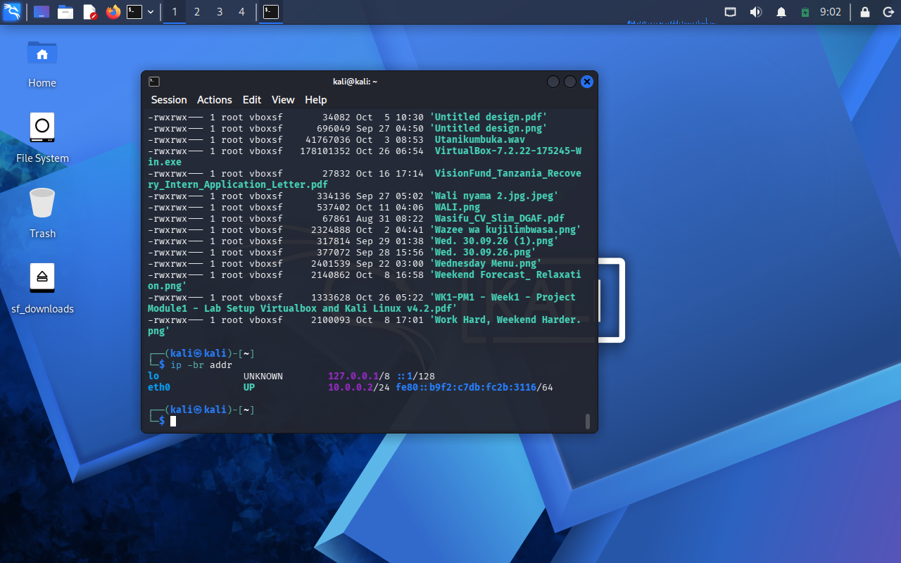
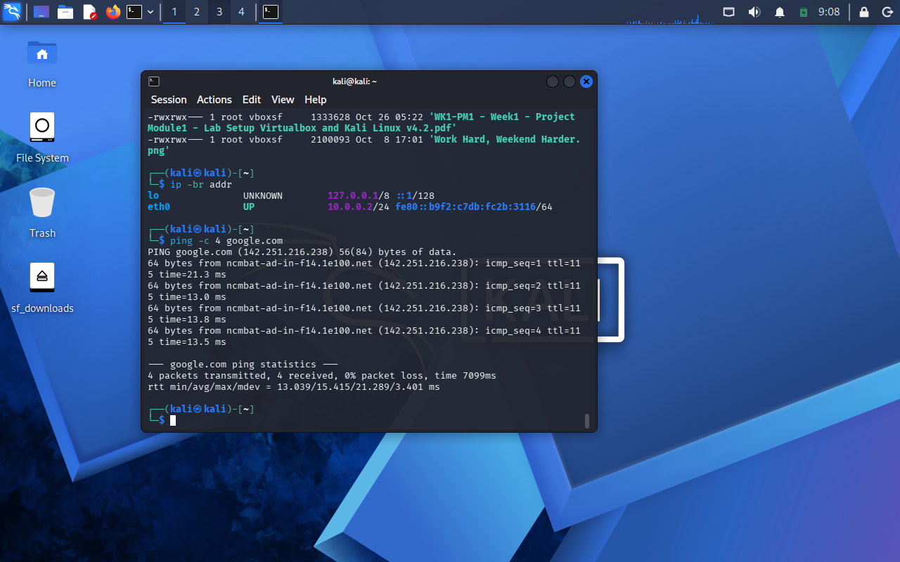
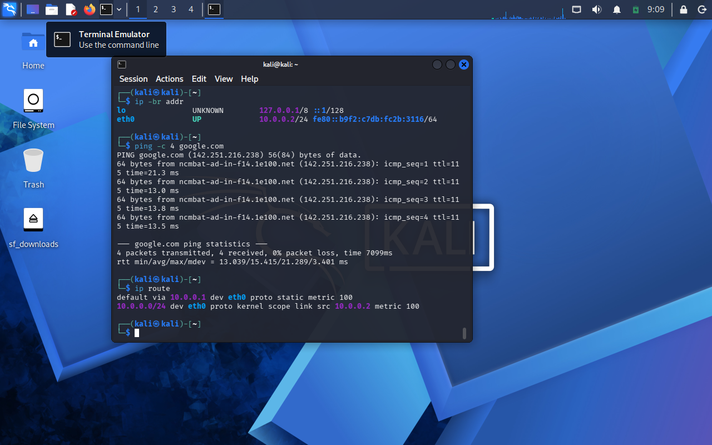
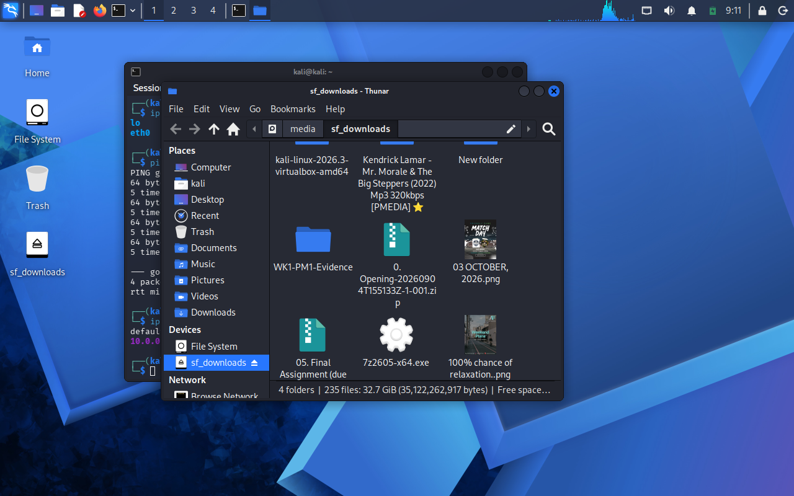
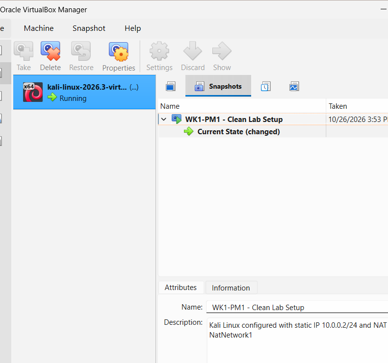

Networkwalks Week 1: VirtualBox and Kali Linux Lab Setup

 1. Project Overview

This project documents the setup of a cybersecurity lab using Oracle VirtualBox and Kali Linux. The lab provides an isolated virtual environment for learning and practicing authorized cybersecurity testing.

 2. Objectives

- Configure a VirtualBox NAT Network.
- Set up Kali Linux as the lab machine.
- Configure a static IPv4 address.
- Verify network connectivity and internet access.
- Enable clipboard sharing and drag-and-drop integration.
- Configure and verify a shared folder.
- Create a VirtualBox snapshot to preserve the lab configuration.

 3. Lab Environment

| Component | Configuration |
|---|---|
| Virtualization software | Oracle VirtualBox |
| Operating system | Kali Linux 2026.3 (64-bit) |
| Network type | NAT Network |
| NAT Network name | NatNetwork1 |
| Network subnet | 10.0.0.0/24 |
| Gateway | 10.0.0.1 |
| Kali static IPv4 address | 10.0.0.2/24 |
| Network interface | eth0 |
| Shared folder | downloads |
| Snapshot | WK1-PM1 - Clean Lab Setup |

4. Network Configuration

The VirtualBox NAT Network was configured with the subnet `10.0.0.0/24` and gateway `10.0.0.1`.

Kali Linux was configured with the static IPv4 address `10.0.0.2/24` using NetworkManager.

The routing table was checked using:

```bash
ip route
```

The default route was confirmed through `10.0.0.1`, and the local subnet route was confirmed as `10.0.0.0/24`.

 5. Connectivity Testing

Internet connectivity and DNS resolution were tested using:

```bash
ping -c 4 google.com
```

The test returned four replies with 0% packet loss, confirming successful connectivity at the time of testing.

The IP configuration was checked using:

```bash
ip -br addr
```

 6. VirtualBox Integration

The following integration settings were configured:

- Shared clipboard: Bidirectional
- Drag and drop: Bidirectional
- Shared host folder: `downloads`
- VirtualBox snapshot: `WK1-PM1 - Clean Lab Setup`

The shared folder was accessible from the Kali desktop through `sf_downloads`.

 7. Evidence

 7.1 Kali Static IP Configuration



 7.2 Internet Connectivity Test



 7.3 Network Routing Table



 7.4 Shared Folder



 7.5 VirtualBox Snapshot



 8. Snapshot and Recovery

A VirtualBox snapshot named `WK1-PM1 - Clean Lab Setup` was created to preserve the configured virtual machine state and provide a recovery point.

 9. Conclusion

The Kali Linux virtual machine was configured with the required static IP address and NAT Network. Internet connectivity, network routing, shared folder access, and snapshot creation were verified.

This lab is intended for cybersecurity learning and authorized testing only.

 10. Reference

Networkwalks Week 1 Project Module 1: Lab Setup VirtualBox and Kali Linux.
